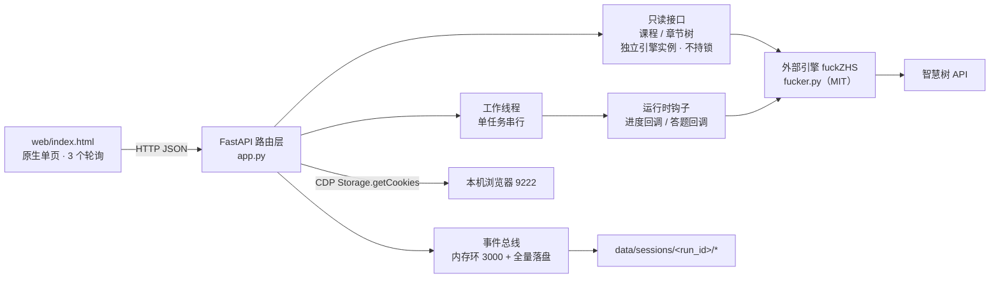

# ZHS Studio

> 把智慧树（知到）共享课的网页播放，变成一个**可停止、可断点续刷、可复盘**的本地面板：自动播完、自动答弹题、每轮留下能直接分析的原始档案。

> ⚠️ **本项目仅供个人学习研究与技术实践。** 禁止用于代刷、代考、代写、商业牟利，或任何违反平台服务条款与学校学术诚信规定的用途。使用可能导致账号被限制或封禁，**风险自担**。完整条款见 [`DISCLAIMER.md`](DISCLAIMER.md) —— 下载或使用即视为接受。

`MIT` · `Python ≥ 3.10`（实测 3.12.8）· Windows / macOS / Linux 均可起服务 · 默认只绑 `127.0.0.1`，要让手机连需显式开局域网开关

---

## 两种用法

同一个后端、同一份 `config.json`，两种形态：

| 形态 | 怎么用 | 入口 |
|---|---|---|
| **① 后端 + web** | `python run.py`（或 Windows 上的 `.\start.ps1`）起服务，浏览器打开 <http://127.0.0.1:8770/>；把 `server.allow_lan` 设成 `true` 后，同网段的手机/平板也能连这个面板 | 本文件「[快速开始](#快速开始)」 |
| **② Windows 桌面应用** | `.\desktop\build.ps1` 打成 exe，双击就开一个原生 WebView2 窗口，**不经过浏览器**，关窗口把后台服务一起停干净 | [`desktop/README.md`](desktop/README.md) |

两者跑的是同一个 `app.py`、同一个引擎、同一套 HTTP 接口——桌面版只是把「起服务 + 开页面」这两步包进一个窗口，**不改变刷课行为本身**（见「已知边界」）。

---

## 为什么需要它

智慧树的共享课播放器有几个绕不开的限制，直接决定了「挂机」这件事在网页上做不到：

1. **必须有人在场**：播放器在页面被切走或系统休眠时常会停播；弹题弹出会中断播放，没人点就一直卡在那里。
2. **跑完只有结论，没有过程**：页面只告诉你「已完成 / 未完成」，不会告诉你每集花了多久、时间花在播放还是卡顿上——于是「倍速还能不能调」永远只能靠猜。
3. **中断后没有「本轮」概念**：平台侧进度是有的，但本地不知道这一轮已经刷到第几集，重开只能从头扫一遍。
4. **命令行脚本是黑箱**：不知道当前在第几集、刚才那条报错是什么、弹题到底答了什么。

ZHS Studio 把上面四件事拆开解决：播放交给成熟的引擎（[fuckZHS](https://github.com/VermiIIi0n/fuckZHS)，MIT），工程层（可视化、断点、限时、档案、复盘）由本项目负责。

---

## 核心能力

### 1. 自动刷课

- **章节树驱动**：拉课程树 → 逐集播 → 播完自动切下一集，全程无人值守。
- **跳过已完成**：同时看两个条件——平台侧 `watchState == 1`（服务端认为完成）与「本轮已完成」（本地记录），任一满足就跳过。
- **断点续刷**：本轮进度落 `data/task-state.json`；进程重启后自动回填「本轮已完成」，不用从头再刷。
- **单集重试**：通用异常重试 2 次（间隔 2s / 5s）；**参数/数据类错误不重试**（重试也不会好，避免 78 集 ×3 次白等）；验证码、限时到点直接上抛不重试。
- **单课限时**：到点收工，且**不把还没播的集写成失败**。
- **随时停止**：在下一个上报点中断，已播进度已落盘；再点开始即续刷。
- **防检测**：引擎内置「每轮循环 0.25% 概率随机暂停 60 秒」，本项目如实记录这段开销（见「实测数据」），不做隐藏。

### 2. 自动答题

播放到弹题点时，引擎拿到的是题目**和正确答案标记**（`questionOptions[].result == "1"`），面板直接把这些选项 id 提交并落库。

> **答案来自服务端下发的正确标记，不是猜测、也不是 AI 生成**。因此不存在「猜错」，但这也不构成对模型解题能力的验证——它是接口把答案一起给了。

- 每题留痕：`questionId / stem / options[{id,text,correct}] / chosen / picked / source / q_keys`。
- 题干字段名各版本不一致，按候选顺序取第一个非空值；少数批次的题**没有文本题干**（推断题干在图片里——`answers.jsonl` 不记录图片字段，无法完全证实），面板显示「（无题干文本）」，选项与提交值仍然完整。
- 章节测验 / 期末考：**未接**（引擎有 AI 考试能力，但需要 `courseId` + `classId`，本项目未做接入验证）。

### 3. 运行档案（这轮到底发生了什么）

每点一次「开始刷课」，就在 `data/sessions/<run_id>/` 下开一个档案目录：

| 文件 | 内容 |
|---|---|
| `meta.json` | 课程、参数（倍速/跳过已完成/限时）、起止时间、结果摘要、失败清单、`episodes_total`、开跑前进度 |
| `events.jsonl` | **全量事件**，一行一条：`{id,t,kind,msg}`，`kind ∈ system/play/progress/done/answer/error`（内存里只留 `bus.capacity` 条，默认 3000，文件里不丢） |
| `episodes.jsonl` | 每集一行：`videoId/name/sec/elapsed/ok/answers/reason/pct_start/pct_end` |
| `answers.jsonl` | 本轮弹题明细 |
| `progress.csv` | 进度采样时序 `ts,videoId,pct`，节流为「≥10 秒 或 ≥5%」采一次（可配） |

刷完用 `tools/report.py` 汇总成复盘报告（markdown / JSON），直接回答「每集多久、哪里失败、弹题答了什么」。

### 4. 可视化

- **单页原生 UI**：一个 `web/index.html`，无框架、无 CDN、无构建步骤，断网也能打开。
- **三栏布局**：课程列表 / 章节树（逐集进度 + 本轮标记）/ 控制台（倍速、限时、跳过、开始停止）。
- **两个 tab**：事件流（自动滚动、当前集高亮）与答题记录（正确项绿色、提交项高亮）。
- **轮询节奏**：状态 1.2s、事件 1s、答题 4s；后端接口都是无状态查询，断了刷新即可恢复。

---

## 架构



无 mermaid 版：

```
浏览器 index.html ──HTTP 轮询──> FastAPI(app.py) ──┬─> 只读接口（独立引擎实例，不持锁）──> fucker.py ──> 智慧树
                                                 ├─> 工作线程（单任务串行）──> 钩子 ──> fucker.py
                                                 ├─> 事件总线（内存 3000 + 全量落盘）──> data/sessions/<run_id>/
                                                 └─> 抓登录态 ──CDP 9222──> 浏览器 ──> data/cookies.json
```

模块、接口契约、设计决策与踩坑清单见 [`docs/architecture.md`](docs/architecture.md)。

---

## HTTP 接口（三端共用）

面板、桌面端窗口、手机遥控端调的是同一组接口，没有「桌面专用」的分支：

| 方法 | 路径 | 说明 |
|---|---|---|
| `GET` | `/` | 面板本体（`web/index.html`，单文件原生页面） |
| `GET` | `/api/health` | 探活。**只回三个键** `{ok, version, uptime_sec}`；不含 uuid、cookie 条数、课程 rac、课程名（这个接口在局域网里最容易被顺手扫到，不能当账号探针） |
| `GET` | `/api/state` | 任务状态 + 登录态摘要（`cookie.ok` / `uuid_prefix`）+ 站点地址 + 默认倍速 |
| `GET` | `/api/events?since=N` | 事件流增量：`{seq, items[]}` |
| `GET` | `/api/answers?limit=N` | 弹题作答流水，最新在前 |
| `POST` | `/api/cookie/grab` | 经 CDP 抓登录态并写 `data/cookies.json`（**会落凭证文件**） |
| `GET` | `/api/courses` | 课程列表 |
| `GET` | `/api/course/{rac}` | 单课章节树（逐集进度 + 本轮标记） |
| `GET` | `/api/sessions?limit=N` | 历史运行档案列表 |
| `GET` | `/api/session/{run_id}` | 单轮档案：`meta` / `episodes` / `events` / `answers` |
| `POST` | `/api/run` | 开始刷课（已有任务在跑时返回 `409`） |
| `POST` | `/api/stop` | 请求停止（在下一个上报点中断，进度已落盘） |

跨源：服务装了 `CORSMiddleware`，`allow_origins` 默认 `*`（`server.cors_origins` 可收紧成白名单），`allow_credentials=False`（`*` 与 credentials 不能共存，浏览器会直接拒），方法限 `GET` / `POST` / `OPTIONS`，预检结果缓存 `max-age=600`。浏览器、pywebview 桌面窗口（`file://` / `null` origin）、规划中的安卓 WebView 壳的 Origin 各不相同，因此各端都能直接调，不需要自己搭反代。

探活约定：任何端启动时先打一次 `GET /api/health`，`ok: true` 才算「连上的是 ZHS Studio 后端」；`version` 取自单点版本源 `zhs_config.APP_VERSION`，`uptime_sec` 是进程启动至今的秒数。桌面端就是靠这个接口决定「窗口什么时候开」。

> 接口**没有鉴权**：没有 token、没有账号校验，登录态是服务端文件 `data/cookies.json`。开了 `allow_lan` 等于把这些读写学习状态的接口放进局域网，前提是你在信得过的网络里（见「已知边界」）。

---

## 实测数据

以下数字全部来自 **14 轮真实运行档案**（14,120 条事件 / 83 集 / 2,714 个进度采样 / 104 条弹题记录，两门共享课），不是估算：

| 指标 | 实测值 | 口径 |
|---|---|---|
| 进度推进倍速 | **1.64×**（中位 1.637，P10–P90 = 1.605–1.655） | `progress.csv` 相邻采样斜率，剔除暂停与重试，n = 70 集 |
| 单集墙钟耗时 | **中位 399s / 均值 421s**（对应视频中位 510s） | `episodes.elapsed`，含暂停与重试，n = 70 集 |
| 非播放开销 | 占墙钟 **24.4%**，其中约 **80%** 是每集一次的 60 秒随机暂停 | 理论 6.58h vs 实际 8.19h（按 1.637× 折算） |
| 客户端随机暂停 | **72 次**，平均 **65.5s/次**，0.85 次/集 | 同集相邻采样 `Δt ≥ 30s` 的空档反推 |
| 弹题 | **104 条**（其中 98 条属于这 14 轮档案，覆盖 72 集） | `data/answers.jsonl` |
| 稳定性 | **12/14 轮跑完**；集级成功 **73/83 = 88.0%**（剔除 3 条旧 schema 记录后 91.3%） | `meta.status` / `episodes.ok` |

三条口径声明（避免误读）：

- **设置 1.5×，实测跑出约 1.64×**，比设置值高约 9.1%。差额原因现有数据**无法判定**，不编解释。
- 那 72 次约 60 秒的停顿是**客户端随机防检测暂停**（引擎内 `random() < 0.0025` → 60s），**不是**平台侧限流：按严格口径（连续 ≥3 采样、跨度 ≥30s、进度不变）平台侧停滞实测 **0 次**。
- 不要引用「墙钟 ÷ 视频时长」当倍速（被暂停稀释，中位只有 1.381），也不要把「提交了服务端正确项」说成「答题准确率 100%」（那是恒等关系）。

完整统计过程、样本量与可复现口径见 [`docs/log-analysis.md`](docs/log-analysis.md)。

---

## 快速开始

### 前置条件

1. **Python ≥ 3.10**（开发与实测环境 3.12.8）。
2. **上游引擎 fuckZHS 2.6.x**（MIT）——**本仓库不包含其源码**，需自行获取：
   ```bash
   git clone https://github.com/VermiIIi0n/fuckZHS.git <引擎目录>
   # 或下载 zip 解压到任意目录
   ```
   目录指到**能看到 `fucker.py` 的那一层**（不是它的子目录）。
3. **一个带调试端口的浏览器**（Edge / Chrome / Brave），用于免扫码抓登录态。

### 安装

```bash
git clone <本仓库地址> && cd <仓库目录>
python -m venv .venv

# Windows
.venv\Scripts\activate
# macOS / Linux
source .venv/bin/activate

pip install -r requirements.txt
```

> **务必用独立 venv**：引擎用平铺模块名互相 import（`utils` / `logger`），若你的全局环境里有同名包，`import fucker` 会打到错误的模块。

### 配置（最少一步）

```bash
cp config.example.json config.json     # Windows: copy config.example.json config.json
```

编辑 `config.json`，把 `engine_home` 填成引擎根目录（绝对路径）。其余项全部有默认值，可以先不动。

不想用配置文件也行，用环境变量：

```bash
export ZHS_ENGINE_HOME=/path/to/fuckZHS     # Windows PowerShell: $env:ZHS_ENGINE_HOME="D:\path\to\fuckZHS"
```

`config.json` 已列入 `.gitignore`，**不要提交**（可能含本机路径；`cookies.json` 更是账号凭证）。

### 启动

```bash
python run.py                 # 读 config.json 的 server.host / server.port（默认 127.0.0.1:8770）
python run.py --port 8780     # 临时换端口
python run.py --host 0.0.0.0  # 临时允许局域网访问（手机/平板连面板）
python run.py --reload        # 开发模式
```

Windows 上也可以用便捷脚本（探测解释器 → 后台起服务 → 打开界面，读同一份配置）：

```powershell
.\start.ps1
.\start.ps1 -Port 8780 -NoBrowser
```

打开 <http://127.0.0.1:8770/>。

**要让手机/平板连**：在 `config.json` 里加 `"allow_lan": true`（`server` 段内），或把 `server.host` 写成 `0.0.0.0`，然后重启服务。启动日志会直接打印可用的局域网地址（下面是输出形状示例，主机位用 `x` 占位，实际打印的是本机网卡地址）：

```
局域网可访问地址（手机端 / 平板端填这个）：
  http://192.168.x.x:8770/     ← 真实网卡（家里 / 公司 Wi-Fi 这条通常是你要的）
  http://10.88.0.x:8770/       ← 虚拟网卡（WireGuard / VPN 隧道）
  http://172.21.x.x:8770/      ← 虚拟网卡（WSL / Hyper-V）
  提示：多网段时选和手机同一个网段的那条（通常是 192.168.x.x）。
```

同时 stderr 会打一行 `[警告] 正在监听非回环地址 0.0.0.0：本服务无鉴权，请确认网络环境可信。`——这是提醒，不是启动失败。

装了虚拟机 / WireGuard / VPN 的机器会多出几个网段，**填错网段连不上**，按提示挑和手机同网段那条。`start.ps1` 末尾也会打一遍这个地址。

> 本服务没有账号鉴权，`/api/cookie/grab` 还会写出登录态文件——只在信得过的 Wi-Fi 里开。同一网络里有不认识的设备时，把 `allow_lan` 关回去（默认就是关的）。

### 首次使用四步

1. **抓登录态**：让浏览器带 `--remote-debugging-port=9222` 启动 → 在浏览器里登录智慧树 → 面板点「抓登录态」。
   - Windows 可用 `.\start-edge-debug.ps1`：它用**独立 profile**（`data/browser-profile`）带调试端口开一个浏览器窗口，**不会关掉你日常的浏览器**；第一次需要在这个新窗口里登录一次。
   - 成功标志：顶栏显示「已登录 · N cookie · xxxxxx\*\*\*」。
   - 抓取结果写入 `data/cookies.json`（**等同账号凭证**，别外发、别提交）。
2. **选课**：左栏点课程，中栏拉出章节树，每集显示平台进度与本轮标记。
3. **开始刷课**：右栏设倍速（默认 1.5×）、单课限时、是否跳过已完成，点「开始刷课」。
4. **随时停**：点「停止」会在下一个上报点中断；再点开始从断点续刷。

---

## 配置说明

优先级：**内置默认值 < `config.json` < 环境变量**。所有相对路径（`engine_home` / `data_dir` / `cookie_file` / `shots_dir` / `browser.profile_dir`）一律**相对仓库根**解析，从任何子目录启动都不会跑偏。

| 键 | 默认值 | 说明 |
|---|---|---|
| `engine_home` | `""` | **必填**。上游 fuckZHS 根目录（含 `fucker.py` 的那层）。为空时启动会报 `EngineNotFound` 并打印安装指引 |
| `server.host` | `"127.0.0.1"` | 监听地址。`127.0.0.1` = 只有本机能连；`0.0.0.0` = 同一局域网可访问（等价于打开 `server.allow_lan`）。本服务无鉴权，先读「已知边界」再开 |
| `server.port` | `8770` | 监听端口，`run.py --port` / `start.ps1 -Port` 可临时覆盖 |
| `server.allow_lan` | `false` | 局域网开关。设 `true` 且 `host` 仍是回环地址时，加载配置会自动把 `host` 换成 `0.0.0.0`——只想控制局域网开/关时翻这一个键就够（`start.ps1` / 桌面端按同样规则处理）。启动日志会打印可用局域网 URL |
| `server.cors_origins` | `[]`（= `*`） | 跨源白名单。留空放开 `*`（pywebview 桌面窗口与规划中的安卓 WebView 的 Origin 各不相同，且服务不发 cookie、不带鉴权）；想收紧就填数组，如 `["http://192.168.1.5:8770"]` |
| `cdp.host` | `"127.0.0.1"` | 浏览器调试端口所在主机 |
| `cdp.port` | `9222` | 浏览器调试端口 |
| `cdp.timeout_sec` | `20` | CDP 连接超时 |
| `cdp.cookie_domain_filter` | `["zhihuishu"]` | 只抓这些域名的 cookie；学校自建站点可追加 |
| `cookie_file` | `"data/cookies.json"` | 登录态落点（不入库） |
| `data_dir` | `"data"` | 数据根目录（档案 / 流水 / 断点状态） |
| `shots_dir` | `"shots"` | `tools/shot.py` 截图输出目录（不入库） |
| `bus.capacity` | `3000` | 内存事件环容量（落盘文件不受影响） |
| `task.default_speed` | `1.5` | 默认倍速。改这里会同步到右栏滑块；**用户拖动滑块后以滑块为准**（`/api/run` 总带具体值，`speed: null` 只是给直接调 API 的人留的后路） |
| `task.retry_delays` | `[2, 5]` | 每集重试间隔（秒），即最多 1 + 2 次尝试 |
| `task.sample_interval_sec` | `10` | 进度采样节流：距上次 ≥10s 采一次 |
| `task.sample_interval_pct` | `5` | 或进度变化 ≥5% 采一次 |
| `site.course_url_template` | `https://studyvideoh5.zhihuishu.com/stuStudy?recruitAndCourseId={rac}` | 「打开课程页」按钮的 URL 模板，`{rac}` 会被替换 |
| `site.home_url` | `https://studyvideoh5.zhihuishu.com/` | 站点首页（备用） |
| `browser.kind` | `"edge"` | `edge` / `chrome` / `brave`；留空 = 自动探测 |
| `browser.path` | `""` | 浏览器可执行文件路径；留空 = 自动探测（注册表 / 常见安装位置） |
| `browser.profile_dir` | `"data/browser-profile"` | 调试用**独立 profile** 目录，不碰日常浏览器 |
| `browser.profile_directory` | `"Default"` | profile 内的子目录名（多账号环境可能不是 `Default`） |
| `_comment` | — | 样例文件里的注释数组，仅供人读，程序忽略 |

环境变量覆盖：

| 变量 | 覆盖项 |
|---|---|
| `ZHS_CONFIG` | 配置文件路径（默认找仓库根 `config.json`，不存在则全用默认值） |
| `ZHS_ENGINE_HOME` | `engine_home`（旧版变量名 `FZ_HOME` 仍兼容） |
| `ZHS_DATA_DIR` | `data_dir` |
| `ZHS_HOST` / `ZHS_PORT` | `server.host` / `server.port` |

> 注意：目前**没有** `--engine-home` 这类命令行参数，改引擎目录请走 `config.json` 或 `ZHS_ENGINE_HOME`。

---

## 数据目录说明

```
data/                              # 全部不入库（.gitignore 覆盖）
  cookies.json                     # 登录态，等同账号凭证 → 绝不提交
  task-state.json                  # 断点续刷状态（本轮已完成 / 失败清单）
  answers.jsonl                    # 弹题流水（全局，追加式）
  runs/<时间戳>_<videoId>.json      # 每集一条运行统计
  sessions/<run_id>/               # 一轮一个档案目录
    meta.json  events.jsonl  episodes.jsonl  answers.jsonl  progress.csv
shots/                             # 界面截图（不入库）
logs/                              # uvicorn stdout / stderr（不入库）
```

- `run_id` 形如 `20260101-120000_1a2b3c4d`（时间戳 + 8 位随机十六进制），**不含课程号**。
- `answers.jsonl`（全局）⊇ 各轮 `sessions/*/answers.jsonl`。
- `episodes.jsonl` 的 `reason`：`done` / `stopped` / `captcha` / `limit` / `error` / `interrupted`；最早两轮的旧记录可能**整行没有 `reason` 键**，统计时要按 `ok` + `events.jsonl` 交叉判定，不能只看 `reason`。
- 这些文件含课程名、课时名、弹题题干与答案，**属于个人学习数据**，分享日志前请先脱敏。
- 桌面版（`desktop\`）用的是同一套目录名，但落在 **exe 旁边**而不是 `_internal\`：`data\`（含 `cookies.json`、`webview\` WebView2 profile）、`shots\`、`logs\desktop.log`。详见 [`desktop/README.md`](desktop/README.md)。

---

## 已知边界

| 事项 | 现状 |
|---|---|
| **91% 完成阈值** | 引擎默认 `end_thre = 0.91`：每集播到视频时长的 91% 就停止上报并视为完成，平台随后把该集标为 `watchState = 1`。所以「已完成」是**平台记账完成**，不等于「播满 100%」 |
| **验证码** | 触发即暂停任务，需去浏览器手动过验证后重开。实测命中率：14 轮里 2 轮（约 14.3%），均在开播约 30.5s 时命中。只拦学习上报，课程列表/章节树等只读接口不受影响 |
| **排查验证码时别搜 `-12`** | 引擎把 `code == -12` 转成异常、面板只写中文提示，**错误码本身不进日志**；要用 `captcha` / `验证码` / `meta.status == "captcha"` 检索 |
| **`code -10` 疑是多窗口观看** | 平台返回「疑是多窗口观看」（实测 1 次），常见于同账号在多处同时播放。遇到先关掉手机 App / 其它标签页 / 其它设备，再重新开始 |
| **AI 角标课程** | 未适配。此类课程的学习上报链路与普通视频不同，需要单独适配 |
| **倍速上限** | 上游默认 1.5×，本项目也只在 1.5× 设置下实测过（实际推进约 1.64×）。更高倍速未经本项目验证，上游 README 提示 1.8× 以上有风控风险——想调请自行承担风险 |
| **章节测验 / 期末** | 面板未接（引擎有 AI 考试能力，需要 `courseId` + `classId`，且需抓一次真实测验请求确定字段） |
| **单点登录** | 平台登录票据是单点的：在手机 App 或别处再登录一次，面板的登录态就失效 → 重新抓一次 cookie |
| **服务无鉴权** | 接口没有 token / 账号校验，`/api/cookie/grab` 还会写出登录态文件。默认只绑 `127.0.0.1`；`server.allow_lan`（= `host: 0.0.0.0`）只为「同网段手机遥控 + 看进度」准备，**不要把端口映射到公网**。同一 Wi-Fi 里有不认识的设备时，把开关关回去 |
| **桌面版不改变引擎行为** | `desktop\` 只是把「起服务 + 开页面」包进一个 exe：**91% 完成阈值、验证码要人工过、单点登录被顶掉、倍速上限与风控**这些全部照旧（见本表其余各行）。换形态不换引擎，别指望桌面版能绕过任何一条 |
| **exe / APK 不入库** | 仓库只留构建脚本与源码，`dist_exe/` 已在 `.gitignore` 里。要 exe 就本地跑 `.\desktop\build.ps1`（约 1~2 分钟，需 PyInstaller + pywebview），或从 GitHub Releases 取；不提交二进制是刻意约定，不是缺文件 |
| **平台接口变动** | 引擎依赖平台接口结构，平台升级即可能失效。引擎不在本仓库内，失效时需跟进上游更新 |

---

## 合规声明

**本项目仅供个人学习、研究与技术交流使用。**

- **不得**用于代考、代刷学分/学时、代替他人完成学习任务；
- **不得**用于任何商业化用途（售卖、代练、引流变现等）；
- 使用者应自行确认所在学校/机构的规定与平台服务条款；使用本项目产生的一切后果（包括但不限于账号被限制、学习成绩被取消）由使用者自行承担；
- 本项目与智慧树 / 知到官方**无任何关联**，未获其授权或认可；
- `data/cookies.json` 等同账号凭证，请勿外发、勿提交、勿在共享环境中使用；
- 若你是平台方并认为本项目存在不当之处，欢迎通过 Issue 联系，我们会配合处理。

如果你只是想「省点时间看完自己选的课」，请把倍速与限时用在自己能接受的范围内；把它当成刷课分的工具，不符合本项目的初衷，也可能违反你所在学校的规定。

---

## 许可与致谢

- 本项目以 **MIT** 许可发布，© 2026 lugabee-labs，详见 [`LICENSE`](LICENSE)（含 Third-party notices）。
- API 层依赖上游 **[VermiIIi0n/fuckZHS](https://github.com/VermiIIi0n/fuckZHS)**（MIT, © VermiIIi0n）。本仓库**不包含**其源码，运行时由用户自行安装；建议 **pin 到具体 commit**（上游 README 曾提示可能下线），并在你的部署记录里写清版本，保证可复现。
- 工程思路（可停止任务、限时、倍速、无人值守的取舍）参考了 Autovisor 这类项目的做法，一并致谢。

---

## 文档索引

| 文档 | 内容 |
|---|---|
| [`docs/tutorial.md`](docs/tutorial.md) | **新手指南**：从下载到刷完一门课的完整流程，两条路线（exe / 源码）、装引擎、抓登录态、参数怎么设、常见问题 |
| [`DISCLAIMER.md`](DISCLAIMER.md) | **免责声明**：用途限定、风险自担、平台无关联、合规提示、责任限制。**使用前必读** |
| [`desktop/README.md`](desktop/README.md) | Windows 桌面端：构建（PyInstaller + pywebview）、onedir vs onefile、首次运行 `config.json`、端口与局域网、数据落点、Defender 排除、已知限制与排错表 |
| [`docs/architecture.md`](docs/architecture.md) | 后端模块划分、接口清单与契约、关键设计决策（D1–D14）、踩坑记录（P1–P12）、数据模型、改造路线与已知债务 |
| [`docs/log-analysis.md`](docs/log-analysis.md) | 14 轮 / 14,120 事件的数据实测：每集耗时分布、倍速口径、暂停与验证码归因、弹题覆盖面、哪些数字不能引用 |
| [`docs/code-audit.md`](docs/code-audit.md) | 开源前审计：硬编码清单、敏感信息清单、必改项、许可证核对、依赖清单与配置草案 |
| [`docs/acceptance.md`](docs/acceptance.md) | 验收与回归记录（接口契约、端到端、并发竞态） |

---

## 常见问题

**启动报 `EngineNotFound`**
`engine_home` 没配、指错层（要指到含 `fucker.py` 的目录）、或目录不完整（应同时有 `utils.py` / `logger.py` / `zd_utils.py` / `ObjDict.py`）。报错会指出具体原因（未配置 / 不是目录 / 缺哪几个文件）并打印安装指引。

**点「抓登录态」提示浏览器里没有目标站点 cookie**
三件事按顺序查：浏览器是否带 `--remote-debugging-port=9222` 启动；那个浏览器里是否**真的登录过**智慧树；`cdp.cookie_domain_filter` 是否覆盖你的站点域名。

**顶栏一直「未连接登录态」，但 `data/cookies.json` 有内容**
登录态过期或不是同一账号（登录票据解析不出账号标识）。重新抓一次；注意单点登录会被手机 App 顶掉。

**刷课期间界面很卡 / 接口超时**
只读接口与播放共用同一个平台账号，平台本身会限速；播放期间拉课程树慢是正常的。日志看 `logs/uvicorn.err.log`。

**换电脑 / 换用户 / 换目录**
不用改代码：所有路径来自 `config.json` 或环境变量，`data/` 与 `.venv/` 都不入库，重建即可。

**手机 / 平板打不开面板**
三步按顺序查：① 服务端日志里有没有打印「局域网可访问地址」——没打印说明还在只绑回环（`allow_lan` 没生效，或改完没重启）；② 手机和 PC 是否同网段——日志里有多条地址时选和手机同网段那条；③ Windows 防火墙是否拦住入站（管理员 PowerShell 放行一次：`New-NetFirewallRule -DisplayName "ZHS Studio" -Direction Inbound -Protocol TCP -LocalPort 8770 -Action Allow`）。

**桌面版双击没反应 / 窗口里是「缺少 fuckZHS 引擎」**
看 exe 旁边的 `logs\desktop.log`（每次启动都写）。这一步的细节、端口避让与数据落点见 [`desktop/README.md`](desktop/README.md) §6–§7、§10。
