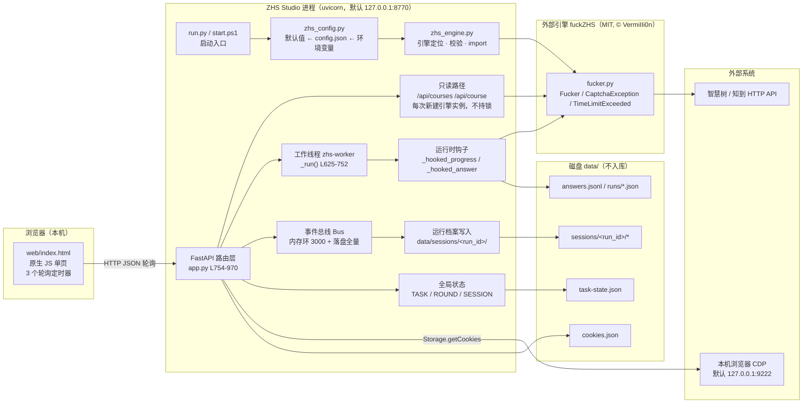

# ZHS Studio 架构说明

> 面向想改代码的人：这份文档说明「哪个文件负责什么」「接口长什么样」「哪些设计是刻意的、哪些是踩坑之后的妥协」。
> 代码基线（2026-11-19 快照）：`app.py` 970 行 / 39,020 B、`web/index.html` 792 行 / 42,326 B、`zhs_config.py` 186 行、`zhs_engine.py` 98 行、`run.py` 56 行、`tools/report.py` 294 行、`tools/shot.py` 108 行。行号按含空行的实际行数标注；若你手里的文件行数不同，以函数名为准搜索（每节都给了函数名）。
> 数据面的事实与口径见 [`log-analysis.md`](./log-analysis.md)，脱敏与改造点见 [`code-audit.md`](./code-audit.md)。

---

## 0. 一句话架构

**一个单进程的 FastAPI 应用 + 一个 daemon 工作线程 + 一个纯原生单页前端**，业务能力全部由外部引擎 `fuckZHS`（MIT）提供，本项目只做「控制台 + 运行档案 + 可视化」这三件工程层的事。

设计边界（刻意不做的事）：

| 不做 | 原因 |
|---|---|
| 多用户 / 多租户 | 本机单人使用，登录态就是一份 `cookies.json` |
| 数据库 | 一轮刷课的档案是「5 个小文件」，用文件系统比建表更利于事后分析 |
| 任务队列 / 多任务并发 | 平台对同账号并发极不友好（实测 `code -10` 疑是多窗口观看），单任务串行是刻意的约束 |
| 自研平台 API | 上游 `fucker.py` 已覆盖课程树、上报、弹题、考试；重复实现等于双份维护 |
| 前端框架 / CDN / 构建 | 单文件 HTML 离线可跑，`git clone` 后不联网也能开界面 |
| vendor 上游源码 | 本仓库不包含 fuckZHS，运行时由用户自行安装（MIT 义务不触发、版本由用户控制） |

---

## 1. 组件视图



同一张图的无 mermaid 版（某些渲染器不支持 mermaid）：

```
启动：run.py / start.ps1 ──> zhs_config.load() ──> zhs_engine.load_engine() ──> import fucker

浏览器 index.html ──HTTP 轮询──> FastAPI 路由层 ──┬─> 只读路径（独立引擎实例，不持锁）──> fucker.py ──> 智慧树 API
                                                ├─> 工作线程 _run() ──> 钩子 ──> fucker.py
                                                ├─> Bus（内存 3000 + 落盘全量）──> data/sessions/<run_id>/events.jsonl
                                                └─> TASK/ROUND/SESSION ──> task-state.json / episodes.jsonl

抓登录态：路由层 ──CDP Storage.getCookies──> 浏览器；结果写 data/cookies.json
```

---

## 2. 模块划分

### 2.1 文件级

| 文件 | 职责 | 关键约束 |
|---|---|---|
| `app.py` | FastAPI 后端：配置装配、引擎加载、档案写入、事件总线、任务执行、11 个路由 | 单文件 970 行，内部按 §2.2 分段 |
| `zhs_config.py` | 配置加载：内置默认值 ← `config.json` ← 环境变量；相对路径统一相对**仓库根**解析；类型兜底 | 全仓库唯一知道「配置文件在哪」的地方 |
| `zhs_engine.py` | 引擎定位与加载：校验 5 个必备文件 → `sys.path` 注入 → `importlib` 导入 → 暴露 `Engine` 数据类 | 全仓库唯一知道「引擎装在哪」的地方；失败抛 `EngineNotFound` 并打印安装指引 |
| `run.py` | 跨平台启动入口：`uvicorn.run("app:app", host/port 来自配置)`，`--reload` 开发模式，非回环地址告警 | 与 `start.ps1` 读同一份配置 |
| `start.ps1` | Windows 便捷启动：解释器探测（`ZHS_PYTHON` → `.venv` → `py -3` → `python`）→ 后台起服务 → 健康探测 → 开界面 | 起不来时 tail `logs/uvicorn.err.log` 并 `exit 1` |
| `start-edge-debug.ps1` | 用**独立 profile**（`browser.profile_dir`）带调试端口启动浏览器，恢复「抓登录态」能力 | 不再杀用户浏览器；浏览器路径探测顺序：`browser.path` → 注册表 App Paths → 常见安装位置 |
| `web/index.html` | 单页 UI：课程 / 章节树 / 控制台 / 事件流 / 答题记录 | 无外部依赖，`fetch` 全相对路径 |
| `tools/report.py` | 把 `data/sessions/*` 汇总成 markdown / JSON 复盘报告 | 只读文件，不走 HTTP；`SESSIONS` 由 `data_dir` 推导 |
| `tools/shot.py` | 通过 CDP 给界面截图（UI 迭代留档） | 开发工具；`--cdp-host/--port/--url/--out` 全部生效，默认读配置 |

### 2.2 `app.py` 内部段落

改代码时按这张表定位，不要跨段改。

| # | 段落 | 行号 | 职责 | 状态载体 |
|---|---|---|---|---|
| 1 | 启动装配 | L12-59 | `CFG = zhs_config.load()`、`ENGINE = load_engine()`、`COOKIE_FILE`、数据目录、`_ensure_dirs()` | 模块级常量 |
| 2 | 档案写入 | L62-153 | `session_file` / `_session_open` / `_session_close` / `_append_text` / `_append_jsonl` | `SESSION` |
| 3 | 事件总线 | L156-183 | `Bus.push()` 分配自增 `id`、截断到 `bus.capacity`、同步落盘本轮 `events.jsonl` | `BUS.items` |
| 4 | 全局状态机 | L185-212 | `TASK`（任务级）、`ROUND`（课程轮次级，跨 run 保留）、`SESSION`（档案级） | 三个模块级 dict |
| 5 | 鉴权与引擎构造 | L214-301 | `load_cookies` / `cookie_info`（只回 `uuid_prefix`）/ `make_fucker` / `grab_cookies`（CDP 参数全来自 `cdp` 段） | `data/cookies.json` |
| 6 | 状态持久化 | L304-435 | `save_task_state` / `load_task_state` / `write_episode_stat` / `_restore_round` / `_mark_interrupted_sessions` | `task-state.json`、`runs/*.json` |
| 7 | 课程树投影 | L438-486 | 把引擎的 `ctx.chapters` 拍平成前端要的 `{chapters:[{videos:[...]}]}` + `stats` | 纯投影，无状态 |
| 8 | 运行时钩子 | L489-584 | 替换引擎的 `progressBar` 与 `Fucker.answerZhidao`，把进度/弹题变成事件与档案 | `TASK["pct"]`、`SESSION["last_sample_*"]` |
| 9 | 单集重试 | L587-622 | `_play_with_retry`：1 + len(`task.retry_delays`) 次尝试，按异常类型分流 | 无 |
| 10 | 任务主体 | L625-752 | `_run()`：挑集 → 逐集播 → 分类收尾（done/stopped/captcha/limit/error） | 全量 |
| 11 | API 层 | L754-970 | 11 个路由 + `RunReq` / `RunReq.speed: float \| None` | 只读为主 |

### 2.3 线程模型

| 执行体 | 来源 | 做什么 | 持锁 |
|---|---|---|---|
| 导入期（主线程） | `import app` | 读配置、定位引擎、加载上游模块；失败即 `EngineNotFound`（uvicorn 起不来） | 无 |
| uvicorn 事件循环 | 主线程 | 接收连接、调度 | 无 |
| FastAPI 同步路由线程池 | `def`（非 `async def`）路由自动进 threadpool | `/api/courses`、`/api/course` 会真发 HTTP 到平台，可能几秒到几十秒 | 刻意**不持** `LOCK`（见 D2） |
| `zhs-worker` | `/api/run` 里 `threading.Thread(daemon=True)` | 串行播完整轮 | 每次调用 `fuckZhidaoVideo` 前后持 `LOCK` |
| 进程收尾 | 无 | `daemon=True`，进程死不保证收尾，靠启动恢复（`_mark_interrupted_sessions`）兜底 | 无 |

锁一览：

| 锁 | 保护对象 | 为什么需要 |
|---|---|---|
| `LOCK = threading.RLock()` | 「会播视频」的引擎调用（`fuckZhidaoVideo`、`getZhidaoContext`） | 引擎实例内部有共享可变状态，并发播会互相踩 |
| `RUN_GATE = threading.Lock()` | `/api/run` 的 check-and-set | 防并发双开（TOCTOU） |
| `SESSION["lock"]` | 档案计数器 `episodes_ok/fail` | 钩子与任务主体都会写 |
| `Bus.lock` | 事件列表与 `seq` | 多个线程同时 push |
| `TASK` / `ROUND` | —— **无锁** | 已知债务，见 §9 |

---

## 3. 接口清单

服务默认 `127.0.0.1:8770`（读 `server.host/port`），全部返回 JSON（`/` 除外），失败统一 `{"ok": false, "error": "<中文原因>"}`。

| # | 方法 | 路径 | 参数 | 返回要点 | 谁在用 |
|---|---|---|---|---|---|
| 1 | GET | `/` | — | `web/index.html`（`FileResponse`） | 浏览器 |
| 2 | GET | `/api/state` | — | `TASK` 全字段（去掉 `stop`/`thread`）+ `cookie` + `site` + `defaults` + `now` + `bus_seq` + `persisted` | 前端 1.2s 轮询 |
| 3 | GET | `/api/events` | `since` (int，默认 0) | `{seq, items:[{id,t,kind,msg,…}]}`，增量 | 前端 1s 轮询 |
| 4 | GET | `/api/answers` | `limit` (1–500，默认 50) | `{ok,total,items:[…]}`，**最新在前** | 前端 4s 轮询 |
| 5 | POST | `/api/cookie/grab` | `port`（可选，缺省用 `cdp.port`） | `{ok, cookie:{ok,count,uuid_prefix}}` | 前端「抓登录态」 |
| 6 | GET | `/api/courses` | `refresh` (bool，默认 true) | `{ok, courses:[{rac,name,teacher,school,img,progress_text,last_lesson,status}]}` | 前端选课 |
| 7 | GET | `/api/course/{rac}` | `refresh` (bool，默认 true) | `{ok, tree:{rac,name,courseId,chapters[],stats}}` | 前端章节树 |
| 8 | GET | `/api/sessions` | `limit` (1–200，默认 30) | `{ok, sessions:[…], current}`，最新在前 | **前端未用**：外部脚本 / 排查 |
| 9 | GET | `/api/session/{run_id}` | `events`(默认 200)、`episodes`(默认 500) | `{ok, meta, episodes, events, answers}` | **前端未用**：外部脚本 / 排查 |
| 10 | POST | `/api/run` | body `{rac, speed: float\|null, skip_done, limit_min}` | `{ok:true}`；已在跑 → **409** | 前端「开始刷课」 |
| 11 | POST | `/api/stop` | — | `{ok:true}`，幂等 | 前端「停止」 |

`POST /api/run` 的 `speed` 传 `null` 时用 `task.default_speed`；前端目前总是传具体数值。

### 3.1 契约细节（改前端/改后端都要看）

**`/api/state`** 是前端的唯一真相源，前端只依赖这些字段：

```jsonc
{
  "status": "idle|running|stopping|done|error|captcha",
  "rac": "…", "course": "…", "speed": 1.5, "skip_done": true, "limit_min": 0,
  "video": {"videoId": "…", "name": "…", "idx": 3, "total": 78},   // 当前集
  "pct": 51.7,                    // 是「本集」进度，不是整课进度
  "done_count": 12, "fail_count": 0, "answer_count": 7,
  "error": null, "run_id": "20260101-000000_1a2b3c4d",
  "started_at": 1767…, "finished_at": null,
  "cookie": {"ok": true, "count": 95, "uuid_prefix": "a1b2c3"},   // 只回前缀，完整 uuid 不出服务端
  "site": {"course_url_template": "…{rac}", "home_url": "…"},      // 前端不写死站点 URL
  "defaults": {"speed": 1.5},
  "now": 1767…, "bus_seq": 4123,
  "persisted": {"completed_video_ids": ["…"], "failed": []}
}
```

**`/api/events` 的游标语义**：`since` 是「上一次拿到的最大 `id`」，不是索引；`items` 只含 `id > since`。前端每轮成功后把 `S.since` 推到 `seq`。总线只有 `bus.capacity`（默认 3000）条，前端落后超过容量会丢中间事件（档案文件里不丢）。

**`/api/course/{rac}` 的 `tree`** 是本项目最复杂的返回结构，几个字段容易混：

| 字段 | 含义 | 谁用 |
|---|---|---|
| `videoId` | **字符串**化后的 id，前端 `data-vid` 与 `ROUND.completed` 都用它 | 前端、档案 |
| `call_id` | API **原始类型**（int），调 `fuckZhidaoVideo` 必须用它 | 任务主体（经 `_keymap` 再兜一层） |
| `done_flag` | 平台侧 `watchState == 1`（**服务端**已完成） | 「跳过已完成」筛选 |
| `round_done` | **本轮**已完成（内存 + 持久化恢复） | 界面绿标 |
| `fail_count` | 本轮该集已失败次数 | 界面红标 |

`stats.pct` 只统计 `watchState == 1` 的集（`done_sec` 对未完成集不计入），因此界面概览环会「跳格」而不是平滑增长——这是刻意的口径，不是 bug。

**错误码约定**：`/api/run` 返回 409（已在跑）、`/api/session/{id}` 返回 404（无此轮）、其余业务失败 400。前端不看 HTTP 码只看 `ok` 字段。

**两个未接前端的接口**（#8/#9）保留原因：临时排查（「这一轮到底写了多少条事件」）用 curl 比读文件快；也是后续做「历史档案浏览」页的现成后端。

**安全面**：服务无鉴权，只应绑回环地址；`run.py` 对非回环 `--host` 会打印告警。`/api/cookie/grab` 无鉴权、会写凭证文件——这是刻意的「本机工具」取舍，不要把端口映射出去。

---

## 4. 关键设计决策

> 每条格式：**问题 → 选择 → 代价**。想推翻某个决定时，请先读这一节，代价是已知的。

### D1 单任务串行，不做并发

- **问题**：平台对同账号并发播放不友好，实测触发过 `code -10 疑是多窗口观看`。
- **选择**：`zhs-worker` 单线程，一次只跑一轮；`/api/run` 用 `RUN_GATE` 挡住第二次点击。
- **代价**：刷 78 集期间不能同时刷另一门课（但只读接口不受影响，见 D2）。

### D2 只读接口不持大锁，每次新建引擎实例

- **问题**：`fuckZhidaoVideo` 一集要跑几分钟；若 `/api/courses` 复用同一把锁，刷课期间界面刷新直接超时（实测 15s+）。
- **选择**：`/api/courses`、`/api/course` 各自 `make_fucker()` 新建实例，完全不碰 `LOCK`。
- **代价**：多几个引擎实例（每个持一份 cookie 与 requests session），内存开销可忽略；但只读接口会与刷课同时打平台。

### D3 `RUN_GATE` + 先置状态再起线程

- **问题**：早期写法是「检查 `status != running` → 起线程 → 线程里置 running」，两个并发请求会在 worker 置位前都通过检查（TOCTOU）。
- **选择**：在 `RUN_GATE` 临界区内**同步**把 `TASK["status"]` 置 `running`、清 `stop`，再 `t.start()`。
- **代价**：线程若启动失败，状态会卡在 running（靠 `_run` 的 `finally` 兜底，理论上存在窗口）。

### D4 事件双写：内存环 + 全量落盘

- **问题**：前端 1s 轮询怕慢；但「复盘要全量事件」，内存无限增长会炸。
- **选择**：`Bus.push()` 进内存环（容量 `bus.capacity`，超出丢最旧）+ 立刻 append 到本轮 `events.jsonl`（**永不丢**）。文件 IO 放在 `Bus.lock` **之外**，避免写盘卡住事件推送。
- **代价**：落盘是「尽力而为」（异常被吞，见 §9），极端情况下事件流会缺行而内存里有。

### D5 进度采样节流

- **问题**：引擎每秒回调一次，78 集 × 500s ≈ 39,000 行采样，`progress.csv` 会到几 MB 且分析噪声大。
- **选择**：满足「距上次 ≥ `task.sample_interval_sec`（默认 10s）」或「进度变化 ≥ `sample_interval_pct`（默认 5%）」才写一行。
- **代价**：`progress.csv` 不能精确还原暂停起止（60s 暂停内一行都不写），只能看空档——这正是 [`log-analysis.md`](./log-analysis.md) §2 用「相邻采样 Δt ≥ 30s」反推暂停的原因。

### D6 用 monkeypatch 抓进度与答题（不改上游）

- **问题**：上游是平铺脚本，没有回调注册机制；进度只在 `progressBar` 露头，弹题答案只在 `answerZhidao` 出来。
- **选择**：模块级替换 `fzmod.progressBar = _hooked_progress`、`Fucker.answerZhidao = _hooked_answer`；先存原函数（`_orig_answer`），答题钩子内部调用原函数拿返回值。
- **代价**：**脆**。上游改名/改签名即静默失效。代码里已注明彻底方案（`ZhsFucker` 子类 + 显式回调注入），见 §8 与 code-audit §3.1。

### D7 三份状态，各管一段

| 状态 | 生命周期 | 用途 |
|---|---|---|
| `SESSION` | 单轮 | 档案目录、采样节流游标、集计数 |
| `TASK` | 单轮（新任务重置） | 前端要看的实时态 |
| `ROUND` | **跨轮**（换课程才重置） | 「本轮已完成 / 本轮失败次数」，断点续刷的依据 |

- **问题**：只存 `TASK` 的话，进程重启后「哪几集已完成」就丢了，界面绿标消失、重开又从第 1 集开始。
- **选择**：`ROUND` 落 `task-state.json`；启动时 `_restore_round()` 回填；`_run` 开始时若 `ROUND["rac"] == rac` 则**保留**已有进度，否则重置。
- **代价**：`task-state.json` 会把上一轮的 `failed` 清单带进下一轮的 `meta.json`，导致「凭 `meta.json` 数失败次数」被放大（实测 `code -8` 只 1 次却被复制进 11 个 meta——见 §5 P6）。

### D8 失败分型重试

- **问题**：无脑重试会把「参数/数据错误」也重试，78 集 ×3 次白等十几分钟。
- **选择**：`_play_with_retry` 只对通用 `Exception` 重试（间隔取 `task.retry_delays`，默认 2s、5s）；`KeyboardInterrupt` / `CaptchaException` / `TimeLimitExceeded` **直接上抛**；`AttributeError/TypeError/KeyError/ValueError` 判为数据错误，**不重试**。
- **代价**：数据错误一次就判失败（这正是想要的——上游 schema 变了，重试也不会好）。

### D9 限时到点不写集记录

- **问题**：`TimeLimitExceeded` 是在**开播前**由引擎挡下的，这一集根本没播；若按 `ok=false` 写入 `runs/` 与 `episodes.jsonl`，会把「没跑」污染成「失败」。
- **选择**：只落任务级状态（`save_task_state`），break 收工，**不写集记录**。
- **代价**：`episodes.jsonl` 里「还没轮到的集」完全不见（本来就该如此），复盘时用 `meta.episodes_total` 反推。

### D10 前端轮询，不用 SSE / WebSocket

- **问题**：三个数据流（状态 1.2s、事件 1s、答题 4s），用 SSE 会引入连接管理、重连、多标签页竞争。
- **选择**：全部 `fetch` 短轮询；后端接口全是**无状态查询**（除事件游标），重连天然幂等。
- **代价**：空闲时也有 3 个定时器；`S.stateBusy` 这类「防请求堆叠」的补丁是必须的（后端卡住时前端会拖着多个 pending 请求）。

### D11 路径一律从「文件位置 / 配置」推导，不写死

- **问题**：原版把引擎目录、venv、cookie 落点写死在某个 D 盘路径下，换机器必挂。
- **选择**：`HERE = __file__ 所在目录`；`zhs_config` 把 `engine_home / data_dir / cookie_file / shots_dir / browser.profile_dir` 的相对路径统一相对**仓库根**解析；`run_id` 只用时间戳 + 随机串。
- **代价**：配置文件本身成了新的「必须存在的东西」（有默认值兜底，但 `engine_home` 必须填）；换来的是「换电脑只改一个文件」。

### D12 档案目录是「分析数据集」而非日志

- **问题**：跑完一轮想复盘「每集多久、弹题答了什么、进度曲线」，若只有 stdout 全都丢了。
- **选择**：一轮一目录，固定 5 个文件（见 §6），schema 稳定优先于省空间；`progress.csv` 用 CSV 而不是 JSONL，是为了能用任何表格工具直接画图。
- **代价**：`data/` 会持续长大（实测 15 轮 ≈ 1.5 MB，可接受）；且这些文件含课程名/题目/答案，**绝不能入库**。

### D13 配置三层合并 + 引擎定位单点

- **问题**：原版真相分散在环境变量、ps1 参数、请求体、前端默认值四层；引擎加载逻辑（`sys.path` 注入）埋在 `app.py` 顶部。
- **选择**：`zhs_config.load()` 合并「内置默认值 < `config.json` < 环境变量」并统一做类型兜底；`zhs_engine.load_engine()` 负责「校验 5 个必备文件 → `sys.path` 注入 → import」。
- **代价**：多两个文件、多一层间接；收益是改引擎目录/端口/节流不再需要动业务代码。
- **注意**：`sys.path` 注入**没有消失**，只是从 `app.py` 收进了 `zhs_engine.py`——上游是平铺脚本（`utils` / `logger` 这类通用名），只能这么做。正因如此，**必须用独立 venv**，否则同名包会打架。

### D14 `run_id` 不含课程号

- **问题**：原版目录名是 `时间戳_<rac 前 8 位>`，把课程号扩散到 `/api/sessions` 响应、`events` 首行与复盘报告里。
- **选择**：改为 `YYYYmmdd-HHMMSS_<8 位随机十六进制>`（`secrets.token_hex(4)`）。课程号只留在 `meta.json`（`data/` 本来就不入库）。
- **代价**：人眼无法从目录名看出是哪门课（`meta.json` 里有 `course` / `rac`，`/api/sessions` 也会回传，不影响使用）。

---

## 5. 踩坑记录

> 每条：**现象 → 根因 → 修法 → 证据/回归**。这些坑是这份代码最贵的部分。

### P1 抓不到 cookie：`Network.getAllCookies` 被移除 + SQLite 独占锁

- **现象**：想「自己读浏览器 cookie 文件」或调老 CDP 方法都失败。
- **根因**：① Edge 157 起 `Network.getAllCookies` 被移除，等价能力是 browser 级 WebSocket 上的 `Storage.getCookies`；② 浏览器运行时独占锁住 `Network\Cookies` 这个 SQLite，`Copy-Item` 与 `FileShare.ReadWrite` 都拿不到。
- **修法**：`grab_cookies()` 连 `http://<cdp.host>:<cdp.port>/json/version` 拿 `webSocketDebuggerUrl` → `Storage.getCookies` → 按 `cdp.cookie_domain_filter` 过滤 → 重排成引擎要的 cookie 结构落盘到 `cookie_file`。
- **证据**：`app.py` L251-301；实测抓到 95 条（含 HttpOnly 的登录票据与各站点会话 cookie；字段名清单见 code-audit §2.1，本文不复述）。

### P2 `ctx.videos` 的键是 int：str 传进去 → 整轮全失败

- **现象**：界面把 `videoId` 转成字符串回传，`fuckZhidaoVideo` 内部 `ctx.videos[video_id]` 取不到，回退成空 dict，读 `.studyTotalTime` 抛 `'dict' object has no attribute 'studyTotalTime'`，表现为整轮 73/73 集全失败。
- **根因**：上游用 API 原始 int 做键；前端 JSON 里 id 天然是 string。
- **修法**：两层防御——`build_tree` 同时下发 `videoId`（str）与 `call_id`（原始类型）；`_run` 里再建 `_keymap = {str(k): k for k in _ctx.videos.keys()}` 反查。
- **证据**：`app.py` L463-476、L679-691。

### P3 一把大锁拖死只读接口

- **现象**：刷课期间点「刷新课程」，前端 15s 超时。
- **根因**：`/api/courses` 与 worker 抢同一把 `LOCK`，而 worker 一集持锁几分钟。
- **修法**：只读路由改成独立引擎实例、不持锁（代码里有两处「不加 LOCK」的注释）。
- **证据**：`app.py` L826-862。

### P4 防检测暂停复用 `progressBar`：pct 突跳成 1.7 / 51.7

- **现象**：界面上进度偶尔从 1.7% 跳到 51.7%，像卡住又像跳集。
- **根因**：上游把「暂停倒计时」也走 `progressBar` 通道，传的是 `(60-pause, 60)` 且 `prefix` 以 `pause` 开头——即 1/60、31/60 → 1.7%、51.7%。
- **修法**：钩子里 `str(prefix).startswith("pause")` 直接 `return`（不采样、不推事件）。
- **副作用（重要）**：暂停在**事件流里完全无痕**，只在 `progress.csv` 留下 60–70s 的空档。这是 [`log-analysis.md`](./log-analysis.md) §2 必须用「Δt ≥ 30s 空档」反推暂停的原因；分析侧据此得出「平台侧停滞 0 次、72 次全是客户端随机暂停（`random() < 0.0025` → 60s）」。
- **证据**：`app.py` L496-522；上游 `fucker.py` L544-545。

### P5 暂停后 `played_time` 回卷 ≤1.1%

- **现象**：同一集内进度偶尔倒退一点点，进度条闪回。
- **根因**：上游防检测设计（暂停恢复后从略小的值续算）。
- **修法**：**后端不掩盖**（原始数据要真），前端显示层用 `Math.max(lastPct, pct)` 单调化；换集（`videoId` 变）或换任务（`started_at` 变）才归零。
- **证据**：`web/index.html` 状态渲染段（`pollState` 内「同一集内的进度显示只增不减」注释）。

### P6 数据口径坑（来自 14 轮档案复盘，全部会误导读者）

| 坑 | 错在哪 | 正确口径 |
|---|---|---|
| 「`-12` 出现 0 次，所以没触发验证码」 | 引擎把 `code == -12` 转成 `CaptchaException`，前端只写中文提示，**码值不入日志** | 用 `captcha` / `验证码` / `meta.status == "captcha"` 检索；实测 2 次 |
| 「平台风控暂停 72 次」 | 72 次是**客户端随机防检测暂停**（0.25%/秒 × 60s），平台侧停滞严格口径为 **0 次** | 写「客户端随机暂停」，并注明是采样空档反推 |
| 「失败 11 次（按 `meta.json` 计数）」 | `code -8` 只发生 1 次，因 `task-state.json` 持久化被复制进 11 个 `meta.json` | 按独立事件计数（1 次，且不在 14 轮档案内） |
| 「真失败 2 集」 | 老 schema 记录无 `reason` 且 `ok=false`，`events.jsonl` 里明确有「收到停止请求」 | 主动停止，平台侧失败 **0 集** |
| 「答题正确率 100%」 | `chosen == correct` 是**恒等关系**（直接提交服务端 `result=='1'`），不是能力指标 | 写「答案来自服务端标记，不存在猜错」 |
| 「弹题 92 次」 | 那是 12 轮时点的旧报告快照 | 现口径 104 条全局 / 98 条在 14 轮档案内 |

### P7 进程被杀 → `meta.json` 永远 `running`

- **现象**：复盘把「服务重启打断」误判为业务失败，且该轮在 `/api/sessions` 里永远显示运行中。
- **根因**：`meta.json` 的 `status` 只在 `_session_close` 里写；进程被杀时没有机会写。
- **修法**：启动时 `_mark_interrupted_sessions()` 扫 `data/sessions/*/meta.json`，把 `status == "running"` 的改成 `interrupted`，并写 `closed_by: "startup-recovery"` + `note` 说明「不是业务失败」。
- **代价**：只能补状态，补不回丢掉的 `episodes` 行（实测 14 轮里有 1 集答案已落盘但没有 episodes 行）。

### P8 轮次状态污染：上一轮的 `failed` 带进下一轮

- **现象**：新开一轮，`meta.json` 里一上来就有「失败清单」。
- **根因**：`ROUND` 跨轮保留是刻意的（断点续刷），但 `save_task_state()` 把 `failed` 全量写出；下一轮 `_session_close` 又用 `ROUND["failed_list"]` 覆盖 `meta.json`。
- **修法**：目前只做到「换课程即重置 `ROUND`」。**真正该做的是「换 run 即重置 `failed_list`、只保留 `completed`」**，属未完成改造（见 §9）。
- **影响**：分析时必须按 `episodes.jsonl` 而不是 `meta.failed` 计数（对应 P6 的第三条）。

### P9 Windows 上 `os.chmod(0o600)` 是空操作

- **现象**：代码看起来「加固了凭证」，实际在 Windows 只改只读位。
- **修法**：保留调用（POSIX 上有效），注释写明 Windows 的等价做法是 `icacls`；README 也如实说明。
- **证据**：`app.py` L294-300。

### P10 `shot.py --port` 解析了却从未使用（已修）

- **现象（原版）**：`python shot.py --port 9333` 仍然连 9222。
- **根因（原版）**：模块常量 `CDP` 写死 9222，函数里直接用，`a.port` 无引用。
- **修法**：`--cdp-host/--port/--url/--out` 全部生效，默认值改从 `cdp` / `server` / `shots_dir` 读。
- **教训**：参数解析成功 ≠ 参数生效；这类「静默失效」的开关比报错更难查。

### P11 单页前端无 CDN 是刻意的

- **收益**：离线可用（内网/断网也能开界面）、没有供应链风险、审查成本低（一个文件）。
- **代价**：792 行内联 CSS/JS，改样式要滚很远；无构建步骤意味着不能上 TS/组件化。
- **回归**：`web/index.html` 内 0 个 `<script src>` / `<link href>` / `@import`。

### P12 改字段名要连消费点一起改（`uuid` → `uuid_prefix`）

- **现象**：为收紧隐私，`cookie_info()` 只回 `uuid_prefix`（不再回完整 `uuid`），但 `/api/cookie/grab` 的事件文案仍写 `info['uuid']` → `KeyError: 'uuid'` 被同一个 `try` 吞掉，接口恒定返回 400；而 cookie 文件其实**已经写成功**（写盘在 `grab_cookies` 内部），用户很容易误判成「浏览器没登录」。
- **根因**：字段改名只改了定义处（`cookie_info`）与前端渲染处，漏了同文件内的事件文案消费点。
- **修法（已修）**：事件文案改用 `info.get('uuid_prefix')`，并在该行上方留了「这里别再取 info["uuid"]」的防回归注释。
- **教训**：这类「异常被 `except` 吞掉 + 返回值仍是 400」的缺陷，静态 review 很难看出来，**必须真跑一次接口**。本项目的最小冒烟测试就是：打桩 `grab_cookies` → 调 `api_grab()` → 断言 `ok=True`。

---

## 6. 数据模型

### 6.1 一轮的档案（`data/sessions/<run_id>/`）

`run_id` = `%Y%m%d-%H%M%S` + `_` + 8 位随机十六进制（`secrets.token_hex(4)`，**不含课程号**，见 D14）。

| 文件 | 行/条 | 字段 |
|---|---|---|
| `meta.json` | 1 | `run_id, rac, course, course_id, episodes_total, pct_before, params{speed,skip_done,limit_min}, started_at, finished_at, status, done_count, fail_count, answer_count, episodes_ok, episodes_fail, failed[], completed_video_ids[]`；未收尾时另有 `interrupted_at, closed_by, note` |
| `events.jsonl` | 全量，一行一条 | `{id, t, kind, msg}`，`kind ∈ system/play/progress/done/answer/error`；`answer` 带 `options/chosen/picked/questionId`，`progress` 带 `pct` |
| `episodes.jsonl` | 每集一行 | `videoId, name, sec, elapsed, ok, answers, reason, pct_start, pct_end, at, course` |
| `answers.jsonl` | 每题一行 | `t, videoId, questionId, stem, options[{id,text,correct}], chosen, picked, source, q_keys[]` |
| `progress.csv` | 采样 | 表头 `ts,videoId,pct`；节流 ≥10s 或 ≥5%（可配） |

`status`（轮次级）：`running` → `done` / `captcha` / `error` / `interrupted`。
`reason`（集级）：`done` / `stopped` / `captcha` / `limit`（兜底，正常不写）/ `error` / `interrupted`（启动恢复补）。
**老 schema 兼容**：最早两轮的 `episodes.jsonl` 整行**没有 `reason` 键**（不是空值），按 `reason` 归类会得出错误结论——必须用 `ok` + `events.jsonl` 停止事件 + `meta.failed` 三方交叉判定。

### 6.2 跨轮状态（`data/`）

| 文件 | 内容 | 生命周期 |
|---|---|---|
| `cookies.json` | 引擎格式 cookie 数组（含 HttpOnly） | 每次抓取覆盖写；**等同账号凭证** |
| `task-state.json` | `rac, course, status, started_at, finished_at, completed_video_ids[], failed[], answer_count, done_count, fail_count` | 覆盖写；进程重启后 `_restore_round()` 回填 |
| `runs/<ts>_<videoId>.json` | 单集：`videoId, name, sec, elapsed, ok, answers, reason, pct_start, pct_end, at` | 只增（每集一个文件，便于 grep/统计） |
| `answers.jsonl` | 全局弹题流水（与每轮 `answers.jsonl` 同 schema，追加） | 只增 |

**不变式**：`answers.jsonl`（全局）⊇ 各轮 `answers.jsonl` 之和；`episodes.jsonl` 行数 = `episodes_ok + episodes_fail`（正常情况下）；`task-state.completed_video_ids` ⊇ 本轮 `episodes.jsonl` 里 `ok=true` 的集。实测 14 轮有个反例：1 集答案已落盘但 episodes 行缺失（进程退出打断），见 P7。

---

## 7. 前端结构

| 区块 | 职责 | 轮询 |
|---|---|---|
| 左栏 课程列表 | `/api/courses`，空态分「未连接登录态 / 未选课程」两种 | 手动刷新 + 登录态变化时自动拉 |
| 中栏 章节树 | `/api/course/{rac}`，逐集显示平台进度条与「本轮已完成/失败 N 次」 | 手动刷新 |
| 右栏 控制台 | 倍速滑块、单课限时、跳过已完成、开始/停止、当前集高亮 | 状态 1.2s |
| 底部 事件流 / 答题记录 | 两个 tab；事件流自动滚动，答题记录渲染正确项与提交项 | 事件 1s、答题 4s |

前端状态 `S` 的关键字段：`rac, speed, limit, skip, since, running, stateBusy, cookieOk, coursesReady, treeKind, site, speedTouched, lastPct, lastVid, lastStart`。

五个隐式契约（改后端时别破坏）：

1. `state.pct` 是**本集**进度，且只增不减（前端 `Math.max` 单调化，换集/换任务才归零）；
2. `state.bus_seq` 与 `/api/events` 的 `seq` 同源，前端用它判断是否落后；
3. `state.cookie.uuid_prefix` 是**前缀**（不是完整 uuid），前端自己拼 `***`；
4. `state.site.course_url_template` 里含 `{rac}` 占位符，前端负责替换——站点地址改配置即可，不用改前端；
5. `state.defaults.speed` 只在「用户没动过滑块」时应用（`S.speedTouched` 守卫），一旦用户拖动，以滑块为准——避免轮询把用户的选择冲掉。

---

## 8. 已完成 / 待完成的改造

对照 [`code-audit.md`](./code-audit.md) §3，开源化改造的落地情况：

| # | 改造 | 状态 |
|---|---|---|
| 1 | 引擎目录不再硬编码，失败给安装指引 | ✅ `zhs_engine.load_engine()` + `EngineNotFound` |
| 2 | 配置分层（默认值 / config.json / 环境变量），路径相对仓库根 | ✅ `zhs_config.py` |
| 3 | 删掉 `os.chdir(FZ_HOME)` | ✅ 已删（上游按 `__file__` 定位，不需要 chdir） |
| 4 | cookie 落点从引擎目录迁到 `data/` | ✅ `cookie_file`，启动自动建目录 |
| 5 | 跨平台启动入口 | ✅ `run.py`；`.ps1` 降级为 Windows 便捷脚本 |
| 6 | 全量 uuid 不下发前端 | ✅ `/api/state` 只回 `uuid_prefix` |
| 7 | `run_id` 不含课程号 | ✅ `secrets.token_hex(4)` |
| 8 | 不再强杀用户浏览器 | ✅ `start-edge-debug.ps1` 改用独立 `--user-data-dir` |
| 9 | `shot.py --port` 无效、venv 绝对路径 | ✅ 已修 |
| 10 | 前端应用配置默认倍速（`defaults.speed`，带「用户拖动后不覆盖」守卫） | ✅ 已做 |
| 11 | **抽 6 方法引擎适配层**（`list_courses / course_tree / play_video / answer_hook / progress_hook / cookie_from_cdp`） | ❌ 未做：`app.py` 仍直接调用 `Fucker` 的 8 个方法 |
| 12 | **去 monkeypatch**（`ZhsFucker` 子类 + 显式回调注入） | ❌ 未做（`app.py` L489-492 已注明方案） |
| 13 | `sys.path` 注入改 `importlib.spec_from_file_location` | ❌ 未做（上游平铺模块互相 import，改成按文件加载会打断其内部 import；只能在独立 venv 前提下保留 `sys.path`） |
| 14 | `/api/cookie/grab` 加最小防护（Origin / 一次性 token） | ❌ 未做，靠「只绑回环」这一条约束 |
| 15 | 给 `pause` 推一条 `kind=pause` 事件 | ❌ 未做（做了之后暂停就能自证，不必靠采样空档反推） |

---

## 9. 已知债务（如实记录）

1. **`TASK` / `ROUND` 无锁读写**：worker 写、路由线程池读，靠 GIL 与「字典整体赋值」侥幸；改异步或换实现后可能读到撕裂状态。
2. **30 处 `except Exception`，其中 19 处直接 `pass`**：档案写入、meta 更新都走这个路径——出问题时**没有任何痕迹**。至少事件落盘与 `meta` 写入应打一行 `warn`。
3. **`ROUND.failed_list` 跨轮污染**（P8）未真正修。
4. **`meta.failed` 不可作为失败计数依据**（P6）——schema 上应标注「本轮累计，含历史」或拆成 `failed_this_run`。
5. **无测试**：全部验证靠人工端到端（`docs/acceptance.md` 记录了 1 次不通过与 1 次回归通过）；钩子、重试分型、限时不写集记录、`/api/cookie/grab` 这四处最该有单测/冒烟测试。
6. **单文件 970 行**：按 §2.2 的段落表拆成 `routes/`、`session/`、`engine/` 是低风险重构，但会破坏「一个文件看懂全貌」的优点，建议与适配层改造一起做。
7. **前端初始值仍与配置各有一份**：`#speed` 的 `value="1.5"` 与 `S.speed:1.5` 是首屏未拿到 `/api/state` 前的占位；真实默认值随后由 `defaults.speed` 覆盖（有 `speedTouched` 守卫）。若把 `task.default_speed` 设成非 1.5，首屏会有一瞬 1.5× 再跳变——要彻底消除得让首页静态值也读配置（需要模板化，与「单文件无构建」取舍冲突）。

---

## 10. 参考

- [`log-analysis.md`](./log-analysis.md)：14 轮 / 14,120 事件的实测数据与口径（本文 P4/P6 的数据面依据）
- [`code-audit.md`](./code-audit.md)：硬编码、敏感信息、许可证、依赖与改造清单（本文 §8 的来源）
- 上游 `fuckZHS`（MIT, © VermiIIi0n）：引擎 API、`end_thre` 默认 0.91、知到默认倍速 1.5
